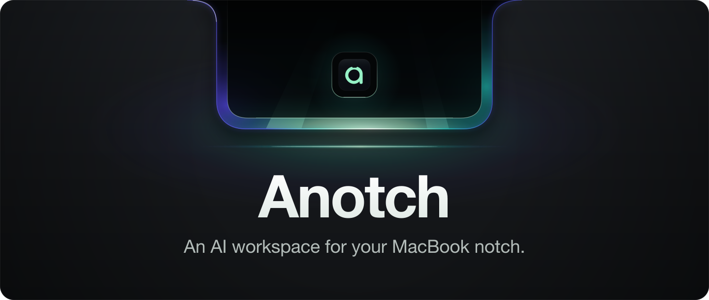
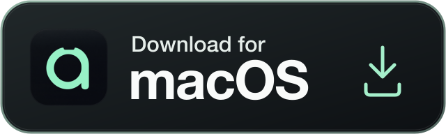
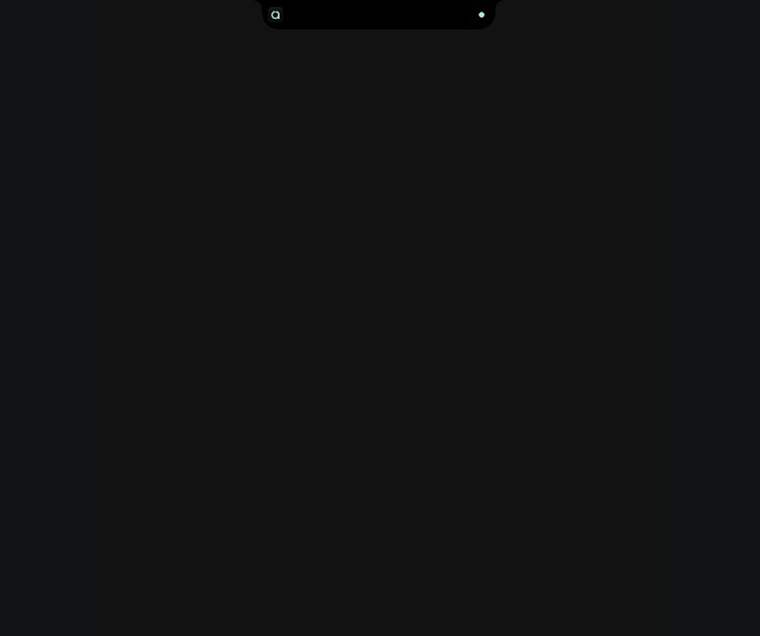
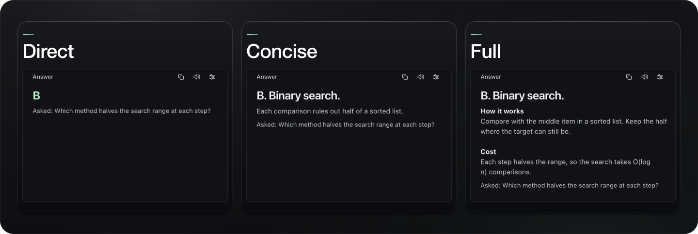
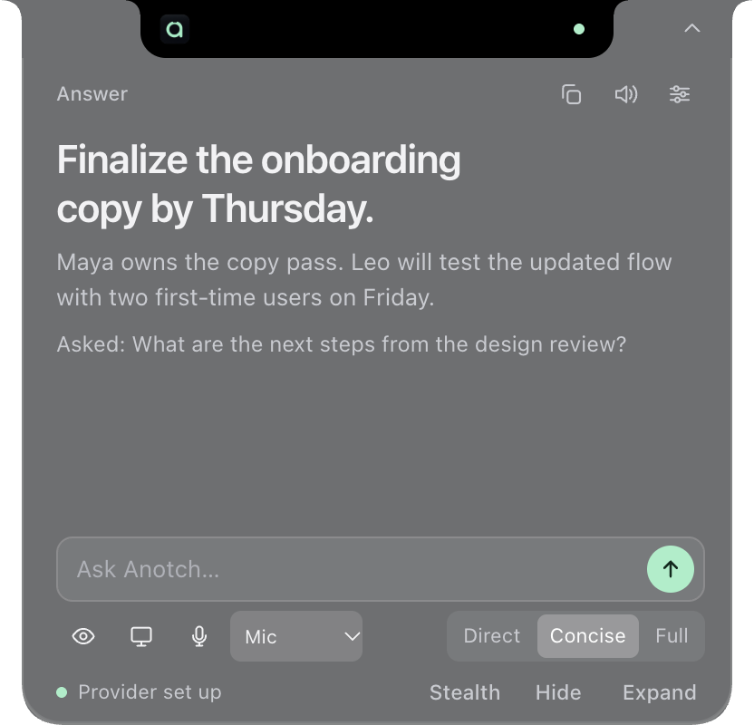
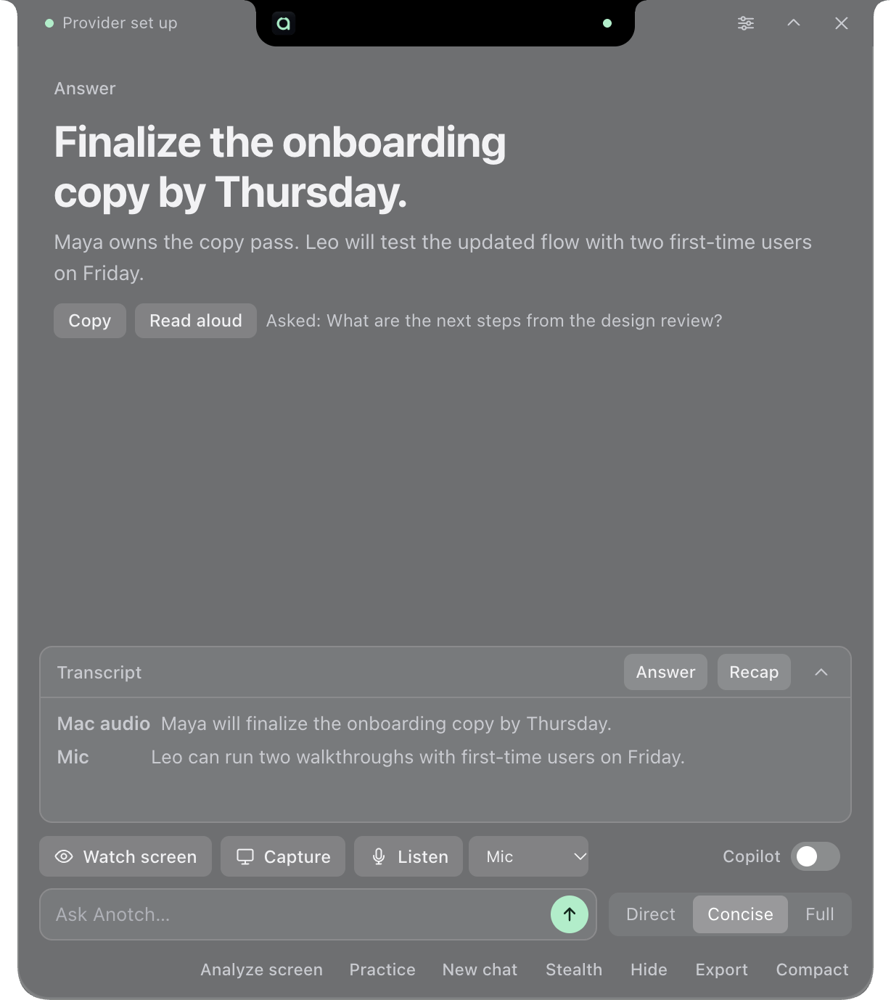
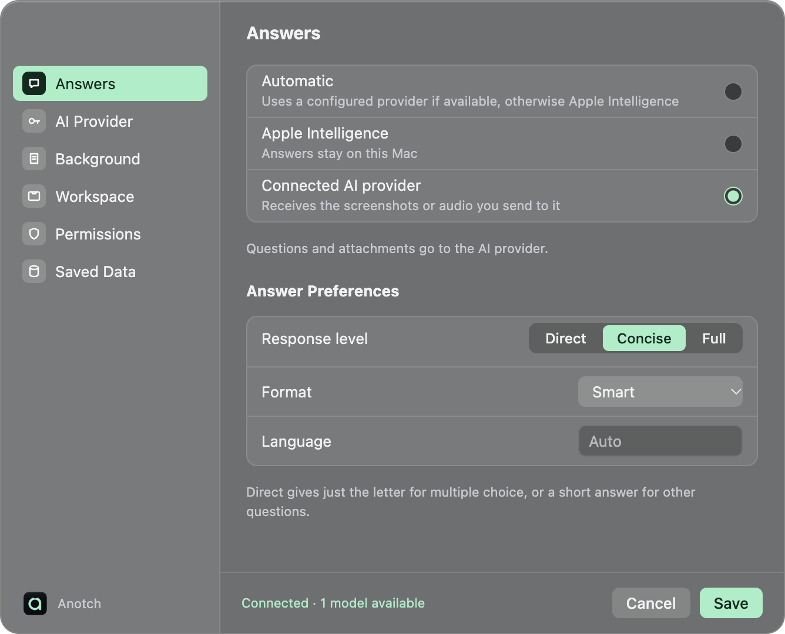

<p align="center">
  
</p>

<p align="center">
  <a href="https://github.com/enterprisetrapper/anotch-app/releases/latest/download/Anotch-Mac-Apple-Silicon.dmg"></a><br>
  <sub><strong>Public preview DMG</strong> &middot; Apple silicon &middot; macOS 15 or later</sub>
</p>

<p align="center">
  <a href="#use-cases">Use cases</a>
  &middot; <a href="#quickstart">Quickstart</a>
  &middot; <a href="#screenshots">Screenshots</a>
  &middot; <a href="https://github.com/enterprisetrapper/anotch-app/releases/latest">Latest release</a>
</p>

<p align="center">
  
</p>

# Ask from the MacBook notch

Anotch is a small workspace for questions about what’s on your screen or what was said. Bring a window, a transcript, or a typed question, then pick how much detail you want in the answer.

<p align="center">
  <strong>Works with</strong> Apple Intelligence &middot; OpenRouter &middot; OpenAI-compatible providers
</p>

## Features

<table>
  <tr>
    <td width="50%" valign="top">
      <h3>🖥️ Ask about a window</h3>
      Attach a screenshot with <strong>Capture</strong>. Use <strong>Watch screen</strong> to look for new questions as a selected window or display changes.
    </td>
    <td width="50%" valign="top">
      <h3>💬 Choose the answer length</h3>
      Switch between Direct, Concise, and Full in the composer. Copy the answer or have Anotch read it aloud.
    </td>
  </tr>
  <tr>
    <td width="50%" valign="top">
      <h3>🎧 Work from a transcript</h3>
      Transcribe your mic, Mac audio, or both. Answer the latest question, recap decisions, or export the workspace as Markdown.
    </td>
    <td width="50%" valign="top">
      <h3>📌 Keep it within reach</h3>
      Hover at the notch to preview your latest answer, click to open the panel, or detach it to float beside your work.
    </td>
  </tr>
</table>

## Use cases

- 🛠️ **Troubleshoot an app.** Use `Capture` on the window showing the error.

  *“What does this error mean, and what should I check first?”*

- 📝 **Turn a meeting into a follow-up.** Use `Listen`, select `Recap`, then ask about that recap.

  *“Turn this recap into a checklist using the owners and deadlines it mentions.”*

- 📚 **Check your understanding.** Type a practice question in `Direct` mode, then switch to `Full` for the reasoning.

  *“Why is that option correct?”*

- 🎙️ **Rehearse an interview.** Open `Practice`, respond to the prompt, and select `Finish practice` for feedback.

  *“Tell me about a difficult problem you solved. What did you do, and what changed?”*

## Quickstart

### Install

1. [Download the DMG](https://github.com/enterprisetrapper/anotch-app/releases/latest/download/Anotch-Mac-Apple-Silicon.dmg).
2. Open the disk image, drag **Anotch** into **Applications**, and eject the disk image.
3. Open **Anotch** from Applications. If macOS blocks this first attempt, go to **System Settings > Privacy & Security**, click **Open Anyway** for Anotch, and follow the prompt. [Apple’s first-launch steps](https://support.apple.com/en-us/102445)
4. Click the notch to open the workspace.

The public preview uses ad hoc signing and ships without Apple notarization. Screen and audio permissions are requested when you use those features.

<details>
<summary>Verify the download</summary>

Download the DMG and `SHA256SUMS.txt` from the same [release](https://github.com/enterprisetrapper/anotch-app/releases/latest). Open Terminal in that folder and run:

```sh
shasum -a 256 -c SHA256SUMS.txt
```

</details>

### Set up your first answer

1. Press `⌘,` to open Settings and choose **Answers**.
2. Select **Apple Intelligence** for on-device answers on a supported Mac running macOS 26 or later. To use **OpenRouter**, go to **AI Provider → Use OpenRouter**, enter your key, and run **Test Provider**. You can also enter another OpenAI-compatible endpoint.
3. Save, then type your first question in the notch panel. For screenshots or audio, grant access when macOS asks. The **Permissions** tab opens the relevant settings.

Choose a vision-capable model for screenshot questions with a connected provider. **Listen** uses a compatible audio endpoint from **AI Provider → Audio and Backup** or the main provider.

## Screenshots

### One question, three answer lengths



| Mode | What you get |
| --- | --- |
| **Direct** | A multiple-choice letter, such as `B`, or a one-line answer. |
| **Concise** | The answer first, followed by the key detail. |
| **Full** | The answer with reasoning, context, and trade-offs. |

### Compact panel and expanded workspace

Expand the compact panel to see the transcript, recap a discussion, or try an interview practice prompt with feedback.

<p align="center">
  
  
</p>

The tour and screenshots use sample questions and transcripts.

## Providers, privacy, and permissions

- **On-device answers** use Apple Intelligence on this Mac. Image input depends on macOS and the model’s vision support. Vision OCR reads screen text locally.
- **Connected providers** receive the question and context you send. Listen sends clips to your transcription endpoint. Watch screen can send changed screenshots to your answer provider.
- **Backup models** can retry eligible errors such as a timeout or incompatible image input. Configure a separate backup endpoint in Settings if needed.
- **Saved data** uses macOS Keychain-backed encryption. Manage history in **Workspace** and remove history or keys in **Saved Data**.
- **Screen sharing** varies by capture app and macOS version. Stealth opens a separate capture-protected panel. Check the receiving view before relying on it.

<details>
<summary>See answer settings</summary>

<p align="center"></p>

</details>

## Keyboard shortcuts

| Shortcut | Action |
| --- | --- |
| `⌃⇧G` | Show or hide Anotch. |
| `⌃⇧J` | Focus the question field. In Stealth, capture and ask about the current display. |
| `⌃⇧K` | Exit Stealth and return to the workspace. |
| `⌘,` | Open Settings. |

## Build from source

Use an Apple silicon Mac, Node.js 22.12 or later with its C headers, and Xcode with the macOS 27 SDK.

```sh
git clone https://github.com/enterprisetrapper/anotch-app.git
cd anotch-app
npm ci
npm start
```

```sh
npm run check
npm test
```

To package the public preview on an Apple silicon Mac, run:

```sh
npm run build:preview
```

The build writes `dist/preview/Anotch-Mac-Apple-Silicon.dmg` with ad hoc signing. Each [GitHub release](https://github.com/enterprisetrapper/anotch-app/releases) includes the installer with compiled native helpers, a SHA-256 checksum, and tagged source archives.

<details>
<summary>Build with your own signing certificate</summary>

For a development build, install an Apple Development or Developer ID Application identity and run `npm run build`. Set `ANOTCH_SIGN_IDENTITY` to the exact identity if your Keychain has more than one.

For a notarized build, install a **Developer ID Application** identity and save your Apple notarization credentials in a Keychain profile with `xcrun notarytool store-credentials AnotchRelease`.

```sh
ANOTCH_SIGN_IDENTITY='Developer ID Application: Your Organization (TEAMID)' \
  ANOTCH_NOTARY_PROFILE=AnotchRelease npm run build:release
```

If you saved the profile with `notarytool store-credentials --keychain`, set `ANOTCH_NOTARY_KEYCHAIN` to the same Keychain file when building.

The build writes `dist/release/Anotch-Mac-Apple-Silicon.dmg` after Apple accepts it and the stapled ticket passes validation. Test first launch from a quarantined copy of that DMG on a clean Mac before publishing.

</details>

The Electron workspace and provider routing are in [src](src/), native helpers and packaging are in [scripts](scripts/), and automated checks are in [tests](tests/).

Use [GitHub Issues](https://github.com/enterprisetrapper/anotch-app/issues) to report bugs or suggest improvements.

## License

Anotch is maintained by Enterprise Trapper and distributed under the [MIT license](LICENSE), with the original copyright notices preserved.
